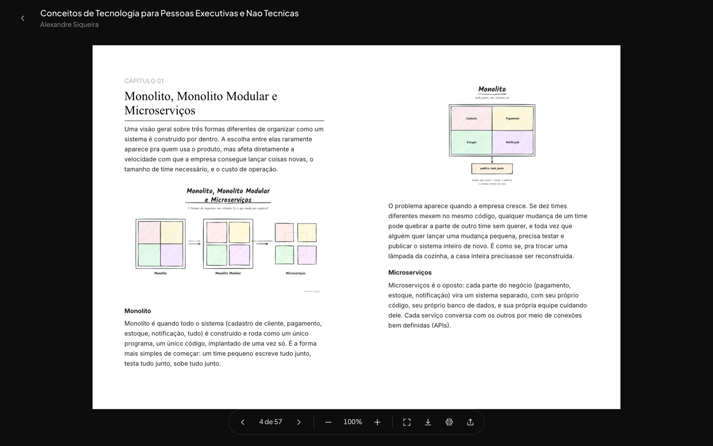
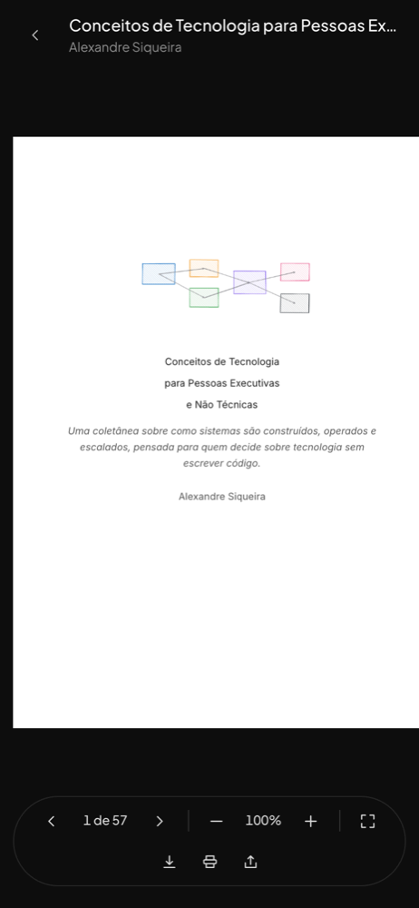
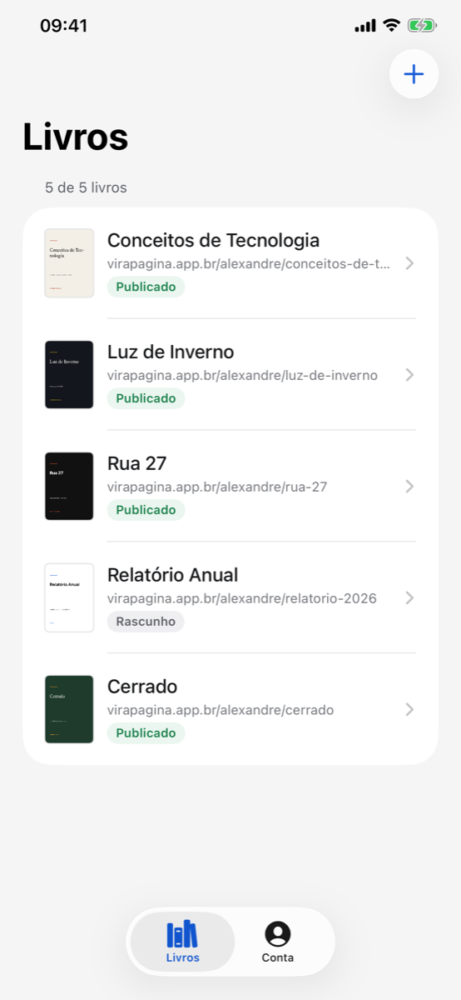
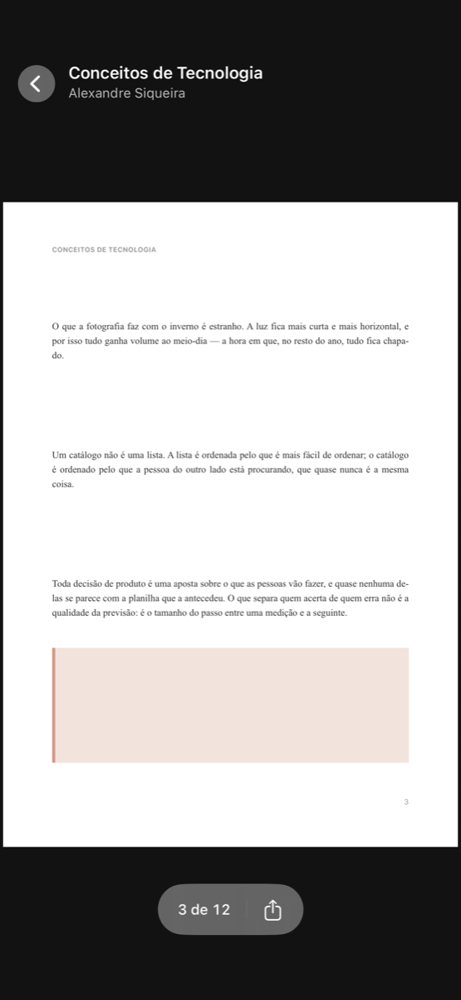

# Virapágina

<p align="center">
  
</p>

<p align="center">
  <a href="https://virapagina.app.br"><b>virapagina.app.br</b></a> ·
  <a href="https://virapagina.app.br/alexandresiqueira">Uma vitrine de exemplo</a> ·
  <a href="https://virapagina.app.br/privacidade">Privacidade</a>
</p>

Plataforma de flipbooks: qualquer pessoa entra com o Google, sobe um PDF e recebe um link onde os leitores folheiam o livro no navegador, sem instalar nada e sem criar conta.

## O endereço é seu

Cada conta ganha uma vitrine com todos os livros publicados, e cada livro tem o próprio link:

- **Vitrine:** `virapagina.app.br/<seunome>`
- **Livro:** `virapagina.app.br/<seunome>/<seu-livro>`

<p align="center">
  
</p>

O endereço é escolhido uma vez, no primeiro login, e não muda depois: é ele que circula por WhatsApp, LinkedIn e e-mail.

## O leitor

O livro abre em página dupla no computador e em página simples no celular. Quem lê não faz conta, não recebe cookie de rastreio e não vê marca d'água. Trocar o PDF de um livro publicado mantém o mesmo link, e quem já tinha aberto vê o arquivo novo na hora.

<p align="center">
  
</p>

## No iPhone

O app de iPhone é o painel do autor no bolso: lista os livros, sobe um PDF novo, publica, compartilha o link e abre o leitor, com a mesma conta do site.

<p align="center">
  
  &nbsp;
  
  &nbsp;
  
</p>

## Principais funcionalidades

- Leitor em flipbook com efeito de virar página, zoom, tela cheia, download, impressão e compartilhamento — responsivo, pensado para o celular.
- O PDF original é renderizado no navegador (PDF.js): o que a pessoa lê é exatamente o arquivo que ela baixa.
- Conta própria por autor, criada com login Google, e um endereço público escolhido no primeiro acesso (`virapagina.app.br/<endereço>/<livro>`).
- Painel do autor: subir, editar, publicar, despublicar, substituir o PDF e excluir os próprios livros. Livro novo nasce como rascunho, com pré-visualização.
- Vitrine pública de cada autor com os livros publicados.
- Limite de livros por plano; enquanto a plataforma estiver aberta a early adopters, contas novas nascem com livros ilimitados.
- Medição de tráfego por conta, com aviso quando passa da franquia.
- App nativo de iPhone para o autor (pasta [`ios/`](ios/)): entra com Google ou Apple, sobe PDF, publica e compartilha; tem assinatura pela App Store.

## Stack técnica

<p align="center">
  
</p>

- **Web:** Next.js 15 (App Router), React 19, TypeScript, Tailwind CSS v4.
- **Leitura de PDF:** `pdfjs-dist` em `<canvas>` + `react-pageflip`.
- **Dados e arquivos:** Cloud Firestore e Cloud Storage for Firebase, acessados só pelo Admin SDK no servidor.
- **Login:** Auth.js v5 (NextAuth) com Google.
- **Deploy:** Vercel (com Vercel Cron para a rotina diária).
- **iPhone:** Swift / SwiftUI (iOS 17+), projeto gerado com XcodeGen, StoreKit para a assinatura.
- **Testes:** Vitest, com testes de integração contra o emulador do Firebase.
- **Instrumentação de uso:** eventos enviados ao [Visão de Produto](https://visaodeproduto.com.br/).

## Como foi construído

O Virapágina foi desenvolvido com Claude (Anthropic) a partir de uma especificação no formato SDD:

- [`spec.md`](spec.md) — a fonte de verdade do produto (plataforma web).
- [`spec-ios.md`](spec-ios.md) — o delta da especificação para o app de iPhone.
- [`CLAUDE.md`](CLAUDE.md) — convenções do repositório e as regras que não podem ser quebradas, para humanos e agentes.
- [`DOCUMENTACAO-TECNICA.md`](DOCUMENTACAO-TECNICA.md) — o que está implementado, incluindo as divergências em relação à spec.
- [`EPICO-COBRANCA.md`](EPICO-COBRANCA.md) — o desenho da cobrança do site, deixado para uma versão futura.

Guardrails que existem no código: testes automatizados em [`tests/`](tests/) (Vitest) cobrindo as guardas de autorização das rotas, o isolamento entre contas, a visibilidade pública de rascunhos e as regras de negócio do plano, além de testes de integração contra o emulador do Firebase. Lint (ESLint) e checagem de tipos (`tsc`) completam a verificação.

## Status

Publicado — no ar em [virapagina.app.br](https://virapagina.app.br/). O app de iPhone está no repositório; o status de publicação dele na App Store não está documentado aqui.

## Rodar localmente

O desenvolvimento roda contra o **emulador do Firebase**, sem credencial nenhuma do Google. O `.env.development` é versionado de propósito e já aponta tudo para o emulador; o `.env.example` lista as variáveis de **produção**.

```bash
npm install
npm run emu          # em um terminal: o emulador (exige Java)
npm run dev          # em outro: o servidor, em http://localhost:3000
node scripts/seed-emulador.mjs caminho/do/arquivo.pdf   # conta de exemplo com um livro publicado
```

O `firebase-tools` não é dependência do projeto: vem por `npx` na primeira vez que você roda `npm run emu`.

O login com Google não funciona contra o emulador sem um OAuth Client ID real; para exercitar o painel, crie um `.env.local` (não versionado) com `GOOGLE_OAUTH_CLIENT_ID` e `GOOGLE_OAUTH_CLIENT_SECRET` de teste.

```bash
npm test             # testes unitários, sem dependência externa
npm run test:emu     # testes de integração — exige o emulador no ar
npm run lint
npm run typecheck
npm run build
```

Para o app de iPhone, veja [`ios/README.md`](ios/README.md).

### Configuração em produção, em resumo

1. Um projeto Firebase dedicado com Cloud Firestore e Storage (o Storage exige o plano Blaze).
2. Uma conta de serviço do Admin SDK e um ID de cliente OAuth do Google (tipo Aplicativo da Web) no mesmo projeto.
3. CORS do bucket aplicado com `node scripts/aplicar-cors.mjs <chave-da-conta-de-servico.json>` (usa o [`cors.json`](cors.json) da raiz). Sem isso o upload falha no navegador.
4. Regras e índices publicados com `firebase deploy --only firestore:rules,firestore:indexes,storage`. Sem os índices compostos, o painel do autor quebra; `node scripts/diagnostico.mjs <chave.json>` mostra o que falta.
5. As variáveis do [`.env.example`](.env.example) configuradas na Vercel.

As regras do Firestore e do Storage negam todo acesso direto do cliente: a aplicação fala com os dois só pelo Admin SDK, no servidor.

## Licença

O código está disponível apenas para leitura e estudo. Veja [LICENSE](LICENSE).

## Contribuições

Issues são bem-vindas; pull requests não são aceitos. Veja [CONTRIBUTING.md](CONTRIBUTING.md).

---

Feito pela [Dab Lab](https://www.dablab.com.br/) — product studio de software e IA que constrói apps para pequenas empresas, startups e áreas dentro de grandes empresas, partindo de uma especificação (Spec-Driven Development) e com as disciplinas de engenharia de software robusta.
